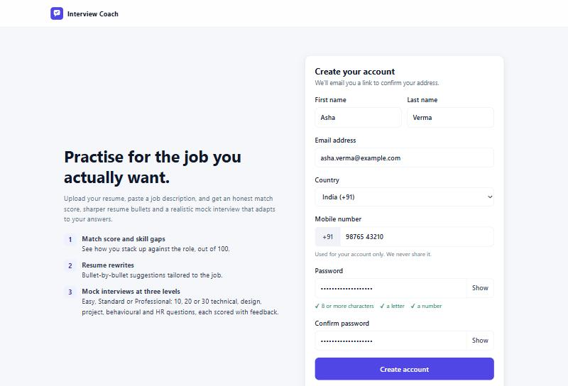
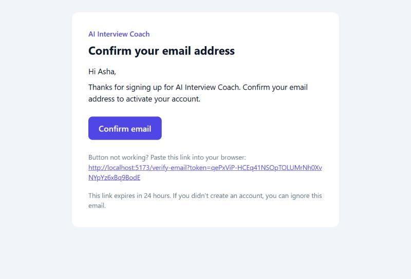
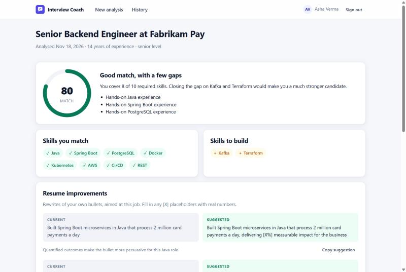
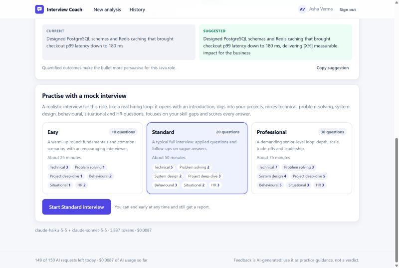
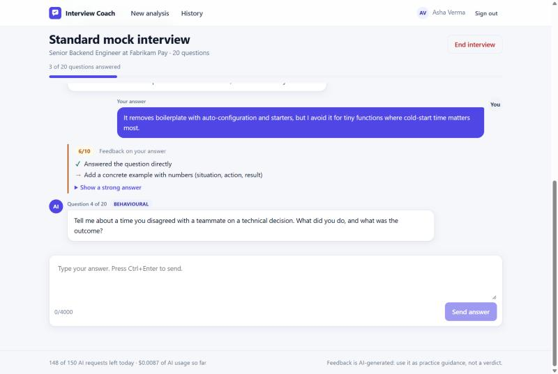
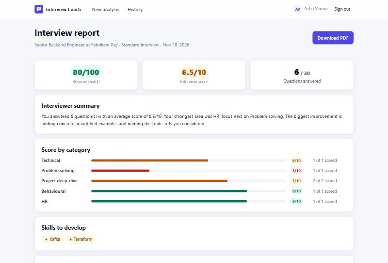
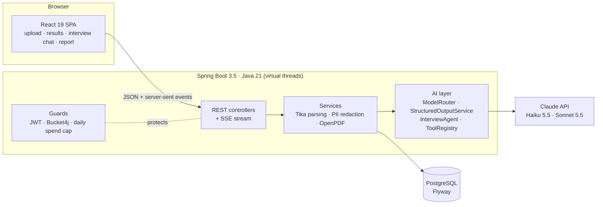
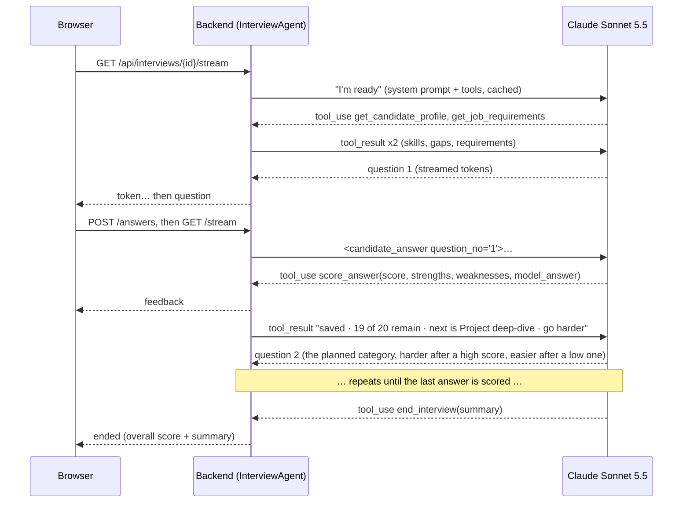

# AI Interview Coach

Upload your resume and paste a job description. You get a **match score out of 100**, the **skills you are missing**,
**bullet-by-bullet resume rewrites** for that job, and a **realistic mock interview** at three levels (10, 20 or 30
questions mixing technical, problem-solving, system design, project, behavioural, situational and HR questions) where
an AI interviewer scores every answer and ends with a **downloadable PDF report** and study plan. Accounts are real:
sign-up with name, email, country and mobile number, **email confirmation**, and password reset by email.

[](https://github.com/<your-github-username>/ai-interview-coach/actions/workflows/ci.yml)


[](LICENSE)

**Live demo:** _add your URL here_ · **API docs:** `/swagger-ui.html` on the backend

| Sign up | Confirmation email | Match analysis |
|---|---|---|
|  |  |  |
| **Interview levels** | **Interview** | **Report** |
|  |  |  |

<sub>The analysis, questions and scores come from the bundled mock Claude API (canned output); the email is the real
HTML message the backend sent, caught by a local SMTP inbox. Replace them, and add a demo GIF, once you have run it
with a real key.</sub>

---

## What it does

| Feature | What you see | How it works |
|---|---|---|
| Resume vs job match | Score out of 100, matched and missing skills | Two parallel Haiku extractions, then a Sonnet comparison with a written scoring rubric |
| Resume improver | Before/after rewrites of your own bullets | Every rewrite must quote a bullet that really exists in your resume (checked in Java) |
| Mock interview | Easy (10), Standard (20) or Professional (30) questions, streamed one at a time | A tool-using agent: it reads your profile and the job, then asks, scores and adapts |
| Question mix | Every question labelled: Technical, Problem solving, System design, Project deep-dive, Behavioural, Situational, HR | A deterministic plan per level, decided in Java and given to the agent, so the mix is guaranteed |
| Live feedback | 0-10 score, strengths, weaknesses, a model answer | The agent records each score through a `score_answer` tool |
| Final report | Web report plus PDF: score per category and a "what to study next" plan | OpenPDF, with the plan generated once and cached |
| Accounts | Sign-up with name, email, country and mobile number; confirmation email; forgot password | Single-use emailed links (only a SHA-256 hash is stored), phone numbers validated with libphonenumber |
| Privacy | Contact details masked before anything is stored | Regex redaction of emails, phones, profile links and addresses |

## Architecture



### The interview loop



## The AI engineering

This is the part worth reading if you are reviewing the code.

**Model routing by cost** ([`AiTask`](backend/src/main/java/com/example/coach/ai/AiTask.java), [`ModelRouter`](backend/src/main/java/com/example/coach/ai/ModelRouter.java))

| Task | Model | Effort | Why |
|---|---|---|---|
| Extract resume / job facts | `claude-haiku-5-5` | low | Simple extraction; about 20x cheaper per token than Sonnet |
| Score the match and rewrite bullets | `claude-sonnet-5-5` | medium | Needs judgement and good writing |
| Interviewer agent | `claude-sonnet-5-5` | medium | Multi-step tool use and answer evaluation |
| Study plan | `claude-haiku-5-5` | medium | Summarising known results |

Extractions are cached on the resume and job rows, so analysing one resume against a new job costs a single cheap
extraction plus the comparison. The two extraction calls run in parallel on virtual threads.

**Structured output that is checked in Java, not just trusted** ([`StructuredOutputService`](backend/src/main/java/com/example/coach/ai/StructuredOutputService.java))
1. The request uses structured outputs (`output_config.format`) with JSON Schemas from [`resources/schemas`](backend/src/main/resources/schemas).
2. The reply is parsed into Java records and validated with Bean Validation (ranges such as a score of 0-100 cannot be expressed in the schema).
3. Semantic checks catch what a schema cannot: every suggested rewrite must quote a real bullet from the resume, and a skill cannot be both matched and missing ([`MatchChecks`](backend/src/main/java/com/example/coach/ai/MatchChecks.java)).
4. If anything fails, the call is **retried once with the problems fed back** to the model. If it is still wrong, a repair step keeps only what can be verified.

**A tool-using agent with guard rails** ([`InterviewAgent`](backend/src/main/java/com/example/coach/ai/agent/InterviewAgent.java), [`tools/`](backend/src/main/java/com/example/coach/ai/tools))
- Tools are Java classes behind a small `AgentTool` interface; Claude decides when to call them. Definitions are `strict` (schema-valid arguments) and use eager input streaming, so inputs are validated client-side before anything runs.
- **Max-steps guard:** each run is limited to a fixed number of model calls, so a confused model cannot loop or burn money.
- **Protocol checks:** if the model asks a question before scoring the answer, or keeps going after the last question, the reply is dropped and the agent is steered with a **mid-conversation `system` message**. History is never edited. Forced `tool_choice` is not available on Sonnet 5.5, so this replaces it.
- **Resumable by design:** the full conversation, including tool calls and thinking-block signatures, is stored as JSON ([`AgentTranscript`](backend/src/main/java/com/example/coach/ai/agent/AgentTranscript.java)) and replayed **append-only**. Newer Claude models reject replayed reasoning if earlier turns change. The next step is always derived from the database, so a page reload, a dropped connection or a server restart picks up where the interview left off.
- Unknown tools and invalid inputs return `is_error` tool results, which the model corrects on its next turn.

**Interview levels and a guaranteed question mix** ([`InterviewLevel`](backend/src/main/java/com/example/coach/ai/agent/InterviewLevel.java), [`InterviewPlan`](backend/src/main/java/com/example/coach/ai/agent/InterviewPlan.java))

| Level | Questions | Technical | Problem solving | System design | Project | Behavioural | Situational | HR |
|---|---|---|---|---|---|---|---|---|
| Easy | 10 | 3 | 1 | 0 | 1 | 2 | 1 | 2 |
| Standard | 20 | 5 | 2 | 2 | 3 | 3 | 2 | 3 |
| Professional | 30 | 7 | 3 | 4 | 5 | 5 | 3 | 3 |

- The category of every question is decided **before** the interview, in Java, and written into the session's (cached) system prompt. Left to itself, a model drifts towards whatever it finds easiest to ask; a plan makes the mix testable.
- The plan opens like a real interview ("tell me about yourself", then a project from your resume), ends with a motivation question, and spreads the rest with **smooth weighted round-robin** (the algorithm nginx uses for weighted load balancing), so the same kind of question rarely comes twice in a row. Other sizes are scaled by largest-remainder apportionment.
- Each level also sets how demanding the interviewer is, from fundamentals with an encouraging tone (Easy) to senior-level probing of depth, scale and trade-offs (Professional). The `score_answer` result tells the agent the next question's category, and the rubric is applied per category (accuracy for technical questions, STAR structure and impact for behavioural ones, judgement for situational ones).

**Prompt caching laid out for reuse** — the request prefix is ordered from most to least shared:

```
tools (identical for everyone) → interviewer rules (identical for everyone) ◆ → level, question plan, resume + job ◆ → conversation so far (automatic) ◆
```

Each `◆` is a cache breakpoint: the rules are cached once for all users, the documents once per session, and each
turn only pays full price for the newest messages. Tool definitions and schemas are loaded from files with stable key
order, so the prefix is byte-identical on every request. Cache hits are logged per call (`cacheRead=` in the logs).

**Cost and abuse control**
- Every call is written to an `ai_usage` ledger (model, input/output/cache tokens, USD), which powers a **deployment-wide daily spend cap** and the cost shown on each analysis and report.
- Bucket4j limits AI requests per user per day, and sign-in attempts per IP per minute.
- Refusals are handled explicitly. Sonnet calls opt in to server-side refusal fallback, so a security-engineering interview that trips a safety classifier can still be served.

**Safety**
- PII is masked before storage or any AI call ([`PiiRedactor`](backend/src/main/java/com/example/coach/service/PiiRedactor.java)). The upload page shows exactly what the AI will see.
- Prompt-injection defence: resumes, job descriptions and answers are wrapped in tags, any copy of the closing tag inside them is neutralised, and the system prompt treats them as data. Operator instructions use the `system` role, never user text.

## Accounts and email confirmation

([`AuthService`](backend/src/main/java/com/example/coach/service/AuthService.java), [`EmailTokenService`](backend/src/main/java/com/example/coach/service/EmailTokenService.java), [`AccountMailer`](backend/src/main/java/com/example/coach/service/AccountMailer.java))

1. **Sign up** with first and last name, email, country and mobile number, and a password (8+ characters with a letter and a number, BCrypt-hashed). The mobile number is checked against the chosen country's numbering plan with Google's [libphonenumber](https://github.com/google/libphonenumber) and stored in E.164 form (`+919876543210`). The country list (with dialling codes) comes from the same library.
2. A **confirmation email** goes out with a single-use link. Signing in is blocked (403 `email_not_verified`) until it is clicked; the sign-in page offers to resend it. Following the link confirms the address and signs you in.
3. **Forgot password** emails a one-hour reset link. Using it also confirms the address, so the owner of an email can always recover an account someone else signed up with.

How the links are protected: each token is 256 random bits; the database stores only its **SHA-256 hash**; links expire (24 h to confirm, 1 h to reset), work **once**, and a new link replaces the previous one. "Resend" and "forgot password" answer the same way whether or not the account exists (no account enumeration), are throttled per IP and send at most one email per minute per account. Emails are sent **after the database transaction commits**, on a virtual thread, so a slow SMTP server never delays sign-up.

Email is plain SMTP, so any provider works (SendGrid, Mailgun, Amazon SES, Azure Communication Services, Gmail). Locally, `docker compose` includes a [Mailpit](https://mailpit.axllent.org/) inbox at http://localhost:8025, and without any SMTP settings the backend prints the links in its log.

## Tech stack

| Layer | Choices |
|---|---|
| Backend | Java 21, Spring Boot 3.5 (Web, Security, Data JPA, Validation, Actuator), virtual threads |
| AI | Anthropic Java SDK 3.10, Claude Sonnet 5.5 and Haiku 5.5, streaming, tool use, structured outputs, prompt caching |
| Data | PostgreSQL 17, Flyway, Hibernate 6 (JSONB) |
| Documents | Apache Tika (PDF/DOCX parsing), OpenPDF (report) |
| Security | Stateless JWT (Spring Security resource server, HS256), BCrypt, Bucket4j + Caffeine |
| Accounts | Spring Mail (SMTP, HTML + text emails), libphonenumber, hashed single-use email tokens |
| Frontend | React 19, TypeScript 7, Vite 8, React Router 7, hand-written CSS (light and dark) |
| Testing | JUnit 5, AssertJ, Mockito, WireMock, MockMvc, Testcontainers, Vitest |
| Delivery | Docker, docker compose (with Mailpit), GitHub Actions (CI, deploy, eval), Azure Container Apps + Static Web Apps |

## Run it locally

You need an [Anthropic API key](https://console.anthropic.com/) for real AI output, or use the bundled mock (option 3).

### 1. Docker (everything in one command)

```bash
cp .env.example .env          # put your ANTHROPIC_API_KEY in .env
docker compose up --build     # app: http://localhost:3000 · confirmation emails: http://localhost:8025
```

### 2. Without Docker

Needs JDK 21 and Node 24. No database setup: `spring-boot:test-run` starts a throwaway PostgreSQL (Testcontainers if
Docker is available, an embedded binary otherwise).

```bash
cd backend
ANTHROPIC_API_KEY=sk-ant-... ./mvnw spring-boot:test-run      # API on http://localhost:8080
cd ../frontend
npm install && npm run dev                                     # UI on http://localhost:5173
```

On Windows PowerShell set the key first with `$env:ANTHROPIC_API_KEY="sk-ant-..."` and run `.\mvnw spring-boot:test-run`.

Without SMTP settings no email is sent: after signing up, copy the confirmation link from the backend console
(look for `Email not sent (no SMTP server configured)`). Set the `MAIL_*` variables to send real email.

### 3. No API key: the mock Claude API

[`dev/mock-claude.mjs`](dev/mock-claude.mjs) speaks the real wire format (JSON and SSE) and plays the interviewer
using the same tool protocol, so you can click through every screen for free. Responses are canned.

```bash
node dev/mock-claude.mjs                                                  # http://localhost:8089
ANTHROPIC_BASE_URL=http://localhost:8089 ANTHROPIC_API_KEY=mock ./mvnw spring-boot:test-run
# or with Docker:
ANTHROPIC_BASE_URL=http://mock-claude:8089 ANTHROPIC_API_KEY=mock docker compose --profile mock up --build
```

### Troubleshooting

- **Signed out after a restart:** set `JWT_SECRET`; without it a new signing key is generated on every start.
- **No confirmation email:** with Docker, open Mailpit at http://localhost:8025. Without Docker and without `MAIL_HOST`, the link is in the backend console. With a real provider, check `MAIL_FROM` is a sender address the provider has verified, and that `APP_BASE_URL` is the address of your frontend.
- **AI features return 503:** `ANTHROPIC_API_KEY` is missing, or today's `AI_DAILY_SPEND_CAP_USD` has been reached.
- **Windows, `Unable to establish loopback connection` at start-up:** some locked-down machines block the socket the JDK uses in the temp folder. Point it elsewhere: `$env:JAVA_TOOL_OPTIONS="-Djdk.net.unixdomain.tmpdir=C:\Temp"`.
- **Port 5432 already in use (Docker):** stop the local PostgreSQL or change the `db` port mapping in `docker-compose.yml`.

## Configuration

All settings are environment variables (defaults in [`application.yml`](backend/src/main/resources/application.yml)).

| Variable | Default | Purpose |
|---|---|---|
| `ANTHROPIC_API_KEY` | _(empty)_ | Claude API key. Without it the app runs but AI endpoints return 503 |
| `ANTHROPIC_BASE_URL` | `https://api.anthropic.com` | Point at the mock for keyless runs |
| `JWT_SECRET` | random per start | HS256 signing key, at least 32 characters |
| `APP_BASE_URL` | `http://localhost:5173` | Address of the web app, used for the links in emails |
| `MAIL_HOST`, `MAIL_PORT` | _(empty)_, `587` | SMTP server for account emails. Empty host: links are logged instead of sent |
| `MAIL_USERNAME`, `MAIL_PASSWORD` | _(empty)_ | SMTP credentials (authentication is used when a username is set) |
| `MAIL_STARTTLS` | `true` | Upgrade the SMTP connection to TLS (set `false` for Mailpit) |
| `MAIL_FROM` | `AI Interview Coach <no-reply@example.com>` | Sender; must be an address your provider allows |
| `DB_URL`, `DB_USERNAME`, `DB_PASSWORD` | local `coach` database | PostgreSQL connection |
| `AI_DAILY_SPEND_CAP_USD` | `5.00` | Hard stop for all AI calls per UTC day |
| `AI_REQUESTS_PER_USER_PER_DAY` | `150` | Analyses, interview starts and answers per user (a 30-question interview uses about 32) |
| `AUTH_REQUESTS_PER_MINUTE` | `10` | Sign-in, sign-up, confirmation and password-reset requests per IP |
| `CORS_ALLOWED_ORIGINS` | `http://localhost:5173,http://localhost:3000` | Needed only when the UI is on another origin |
| `AI_REFUSAL_FALLBACK` | `true` | Server-side refusal fallback on Sonnet calls |

Model ids, effort levels and per-model prices live under `coach.ai` in `application.yml`; questions per level under
`coach.interview` (`easy-questions`, `standard-questions`, `professional-questions`); link lifetimes under
`coach.security`.

## API

Interactive docs: `http://localhost:8080/swagger-ui.html`. Every error is RFC 7807 `application/problem+json` with a
stable `code`.

| Method | Endpoint | Purpose |
|---|---|---|
| POST | `/api/auth/register` | Create an account `{firstName, lastName, email, countryCode, mobileNumber, password}`; emails a confirmation link |
| POST | `/api/auth/verify-email` `{token}` | Confirm the email address; returns a JWT |
| POST | `/api/auth/resend-verification`, `/api/auth/forgot-password` `{email}` | Email a new confirmation / password-reset link (always 202) |
| POST | `/api/auth/reset-password` `{token, password}` | Set a new password; returns a JWT |
| POST | `/api/auth/login` | Sign in (confirmed accounts only); returns a JWT |
| GET | `/api/auth/me` | Current user and profile |
| POST | `/api/resumes` (multipart `file`) | Upload a PDF/DOCX (max 2 MB); returns the redacted text |
| POST | `/api/job-descriptions` | Save a job description |
| POST | `/api/analyses` `{resumeId, jdId}` | Run the match analysis |
| GET | `/api/analyses`, `/api/analyses/{id}` | List / read analyses |
| POST | `/api/interviews` `{analysisId, level?}` | Start an `EASY`, `STANDARD` (default) or `PROFESSIONAL` interview |
| GET | `/api/interviews`, `/api/interviews/{id}` | List / read interviews with every turn |
| POST | `/api/interviews/{id}/answers` `{answer}` | Answer the open question |
| POST | `/api/interviews/{id}/end` | End early |
| GET | `/api/interviews/{id}/stream` | **SSE**: `status`, `token`, `draft_reset`, `feedback`, `question`, `ended`, `error`, `done` |
| GET | `/api/reports/{sessionId}`, `/api/reports/{sessionId}.pdf` | Report as JSON or PDF |
| GET | `/api/usage/me`, `/api/meta` | Your AI usage and remaining requests; public settings, interview levels and categories |
| GET | `/api/meta/countries` | Countries and dialling codes for the sign-up form |

The stream is consumed with `fetch` rather than `EventSource`, because `EventSource` cannot send an `Authorization` header.

## Testing and evaluation

```bash
cd backend && ./mvnw verify        # 67 tests: unit, WireMock, MockMvc, integration (real PostgreSQL)
cd frontend && npm test            # SSE parser, formatting and sign-up validation
```

| Layer | What is covered |
|---|---|
| Unit | PII redaction, document parsing (real generated PDF/DOCX), semantic checks, cost maths, prompt-injection wrapping, tool behaviour, question plans per level, phone number validation |
| AI layer (WireMock) | Retry with feedback, repair, truncation, refusals, agent step limit, protocol steering, early end, transcript round-trip, level and plan in the system prompt |
| HTTP (MockMvc) | Problem+json 401s, forged tokens, field-by-field validation, unconfirmed sign-in, public recovery endpoints, rate limiting, upload errors |
| Integration | Sign up and confirm through the emailed link, upload, analyse, a full interview over SSE, report (with category scores) and PDF against PostgreSQL. It also asserts what was sent to Claude: routing, caching breakpoints, strict tools, and an identical tool/system prefix with an append-only history on every turn. A second flow covers resend, replaced and reused links, and password reset |
| **AI eval** | 20 labelled resume/job pairs (strong, partial and poor fits) with expected score ranges and gaps the analysis must detect |

The eval calls the real models (about $0.50 per run), so it is excluded from the normal build:

```bash
ANTHROPIC_API_KEY=sk-ant-... ./mvnw test -Peval    # writes backend/target/eval-report.md
```

It fails below an 80% pass rate. In CI it runs on demand (*Actions → AI eval*).

> **Eval result:** _run it and record your number here, e.g. "18/20 cases within the expected range"._

## Project structure

```
backend/src/main/java/com/example/coach
├── ai/                  # Claude integration
│   ├── agent/           # InterviewAgent (tool loop + guards), AgentTranscript, InterviewState,
│   │                    # InterviewLevel, QuestionCategory, InterviewPlan
│   ├── tools/           # AgentTool, ToolRegistry, profile/requirements/score/end tools
│   ├── model/           # Structured-output records (ResumeProfile, MatchResult, …)
│   ├── ClaudeClient     # the single gateway: budget check, usage ledger, error translation
│   ├── ModelRouter      # task → model, effort, refusal fallback
│   └── StructuredOutputService, AnalysisPipeline, MatchChecks, PromptTemplates, CostCalculator
├── config/              # Security (JWT, CORS), Claude client, rate limits, OpenAPI, properties
├── controller/          # REST + SSE endpoints
├── service/             # accounts and email, Tika parsing, PII redaction, analyses, interviews, reports, OpenPDF, usage
├── model/ repository/   # JPA entities and Spring Data repositories
└── dto/ security/ exception/
backend/src/main/resources
├── prompts/             # every prompt, as reviewable text files
├── schemas/             # JSON Schemas for structured output and tool inputs
└── db/migration/        # Flyway
frontend/src             # pages, components, api client (fetch-based SSE parser), styles
dev/mock-claude.mjs      # keyless local stand-in for the Claude API
docs/deployment.md       # Azure deployment guide
```

## Deployment

`.github/workflows/deploy.yml` ships the API to **Azure Container Apps** (image in GitHub Container Registry, OIDC
sign-in) and the UI to **Azure Static Web Apps**. It stays off until you set it up: follow
[docs/deployment.md](docs/deployment.md). The backend is a plain container configured by environment variables, so
AWS App Runner or Google Cloud Run work too.

## Design decisions and trade-offs

- **Single instance by design.** Interview runs are serialised with an in-memory guard and the rate limiter is in memory. That is fine for one container (`max-replicas 1`). Scaling out would mean a lease column or advisory lock per session and Bucket4j's JDBC/Redis backend.
- **Messages API with a hand-written loop** (rather than a hosted agent runtime) to own the guard rails, persistence and streaming protocol, and to show how an agent loop works.
- **Server-side fallback on the one-shot Sonnet call only.** The streaming agent replays its transcript with the stable SDK types, so it handles a refusal by asking the candidate to rephrase instead.
- **Spring Boot 3.5** matches the original design. Moving to Spring Boot 4 (Jackson 3, Spring Framework 7) is on the roadmap.
- **Regex PII redaction** is deliberately conservative: it would rather miss an unusual address format than mangle dates and metrics. Names are not redacted.
- **The question plan lives in code, not in the prompt alone.** The model still writes every question, but the category sequence is fixed up front, so "a 20-question interview has 2 system design questions" is a unit test rather than a hope.
- **Stateless JWTs** keep the API simple; the trade-off is that a password reset does not revoke tokens already issued (they expire within 24 hours). A token version column checked on each request would close that gap.

## Roadmap

- Verify mobile numbers with an SMS one-time code; edit profile details
- Spring Boot 4 upgrade
- Voice answers (speech to text) for spoken interview practice
- Shareable report links and history charts
- Horizontal scaling: database-backed session leases and rate limits

## License

[MIT](LICENSE)
